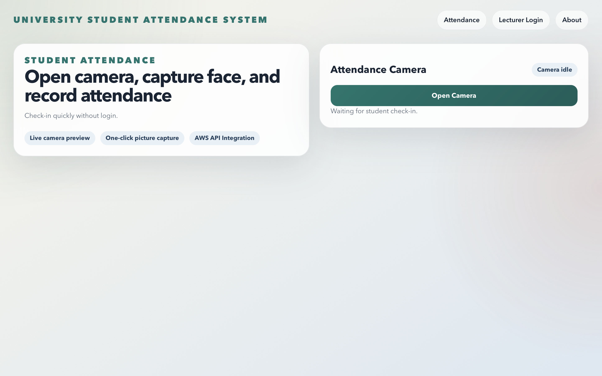
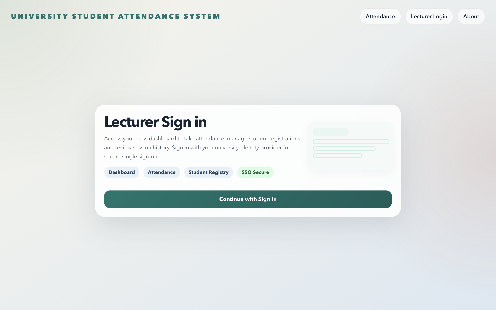
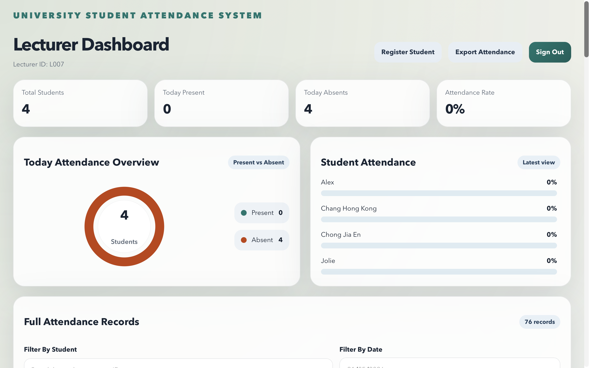
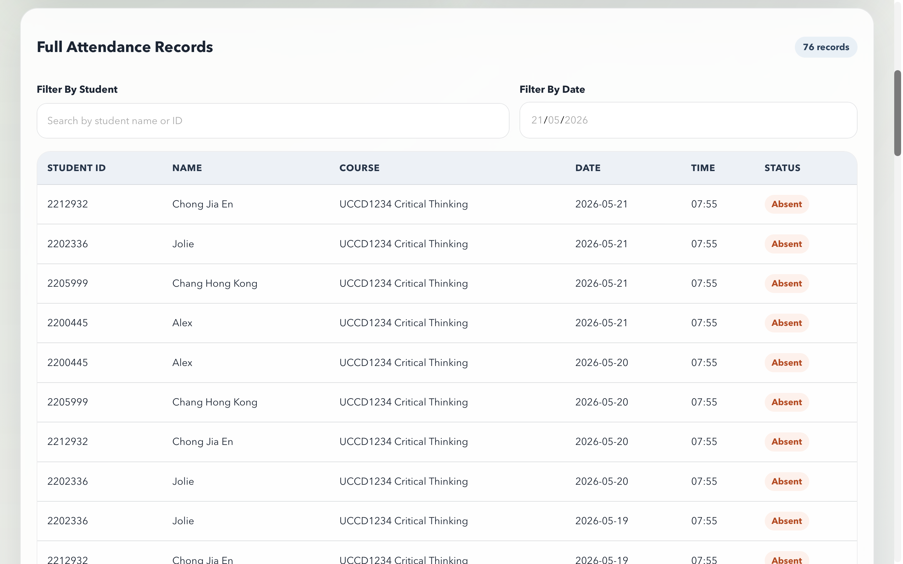
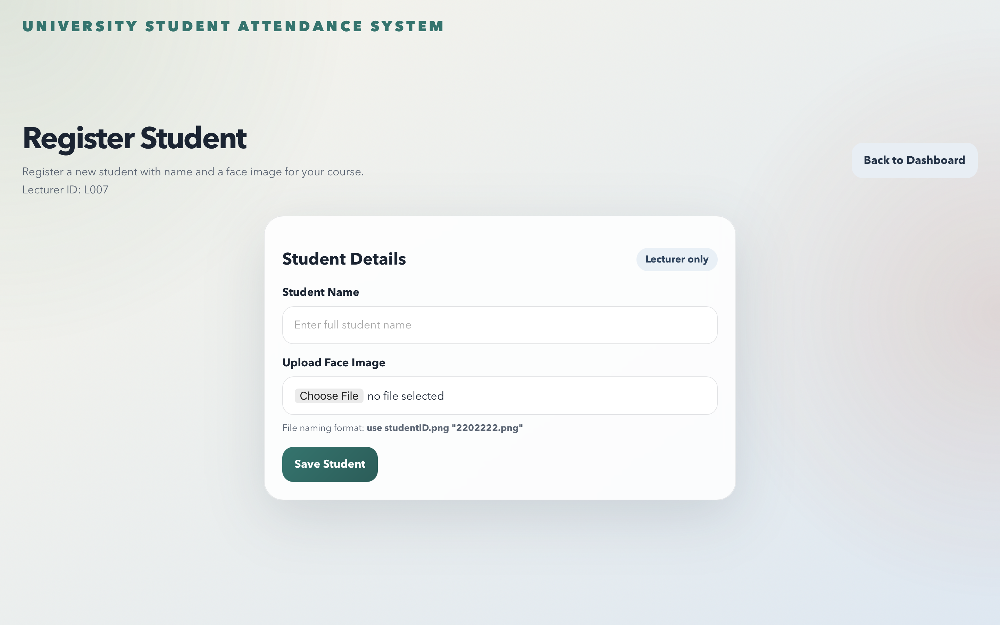

# University Student Attendance System Using Face Recognition

A React web application for automated classroom attendance using AWS face recognition services.

Website link: https://university-student-attendance-syste-six.vercel.app/

## Overview

This project provides two main user experiences:

- Student attendance check-in via camera capture and face matching
- Lecturer dashboard for student registration, attendance monitoring, and CSV export

The frontend integrates with AWS-backed APIs for image upload, attendance processing, analytics, and authentication.

## Features

- Face-based attendance capture from webcam
- Weekend attendance lockout (attendance only on weekdays)
- Lecturer sign-in with Amazon Cognito Hosted UI (OAuth2 + PKCE flow)
- Student registration with face image upload
- Dashboard with attendance summary and records filtering
- Attendance CSV export
- About page with architecture and AWS services overview

## Tech Stack

- React 19
- React Router 7
- AWS Amplify (Auth configuration)
- Amazon Cognito (SSO)
- AWS API Gateway + Lambda (backend APIs)
- Amazon S3 (image/asset storage)
- Amazon Rekognition (face recognition)
- Amazon DynamoDB (attendance/student metadata)
- Amazon Athena (data querying)
- Amazon EventBridge (attendance initialisation)
- AWS IAM (access control and permissions)

## Project Structure

- `src/App.js`: routing, auth session handling, protected lecturer routes
- `src/TakeAttendance.js`: student camera capture and attendance submission
- `src/StudentRegistration.js`: lecturer student registration form and image upload
- `src/Dashboard.js`: lecturer analytics, filtering, and CSV export
- `src/About.js`: architecture and AWS service explanation
- `public/assets/`: architecture and AWS icon assets

## Prerequisites

- Node.js 18+ (recommended)
- npm 9+
- AWS backend endpoints already deployed and accessible
- Cognito Hosted UI domain configured

## Usage

### Student Attendance

1. Open the landing page.
2. Click **Open Camera**.
3. Capture photo.
4. Submit attendance.

Possible outcomes include:
- success
- duplicate attendance
- no face detected
- unrecognized face

### Lecturer Flow

1. Navigate to `/login` and sign in via Cognito.
2. Open Dashboard to view attendance summaries.
3. Register students in `/register-student`.
4. Export attendance as CSV from Dashboard.

## File Naming Rule for Student Registration

Uploaded face image filename must be a 7-digit student ID, for example:

- `2202222.png`

## Interfaces

### Take Attendance

### Lecturer SignIn

### Lecturer Dashboard

### Student Registration

